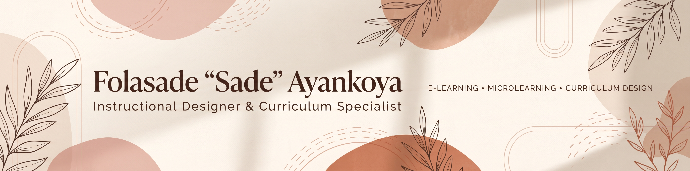

### Welcome to My Instructional Design Portfolio
I am **Folasade "Sade" Ayankoya**, an instructional designer and educator dedicated to creating engaging, learner centered digital experiences and mobile microlearning solutions.

---

### Featured Microlearning Projects
* **[The 3-3-3 Rule Microlearning Guide](https://github.com/fayankoya/the3-3-3-rule-guide)** — A mobile onboarding experience guiding shelter dog adopters through key decompression milestones.
* **[First Day Substitute Teacher Survival Guide](https://sites.google.com/view/firstdaysubstituteteachersurvi/full-page-embed)** — A practical classroom readiness guide supporting educators through morning routines and daily instruction.
